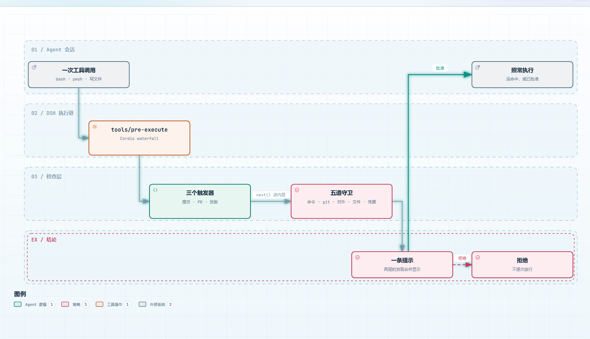

# 贡献指引

感谢你愿意为 dsh-dev-workflow 花时间。本文是本仓库的**协作规则**：怎么报、怎么提、怎么合并。
「怎么在本仓库里改代码」——目录职责、本地循环、测试怎么组织、有哪些坑——在
[`docs/DEVELOPMENT.md`](docs/DEVELOPMENT.md)。两份文档互补，不重复。

动手前请先读 [`AGENTS.md`](AGENTS.md)：那是稳定规则清单，本文是它的展开。

## 这个插件怎么工作

改任何一行代码之前，先建立这张图。所有能力都长在同一个点上。



一次工具调用进入 DSH 后，插件最多挂上八个监听器，分两层：

- **三个触发器**判「合不合规范」——提交信息、PR 描述、版本号与 CHANGELOG。纯函数加一次文件读。
- **五道守卫**判「回不回得来」——命令、git、对外操作、读文件、凭据外泄。默认 `ask`，不替用户决定。

两层都命中时只出一条提示，两边的理由合并显示，不会连问两次。

## 报障与提议

报障请用 [bug 报告表单](.github/ISSUE_TEMPLATE/bug-report.yml)。它强制填两项：DSH 版本、
以及 `/dev-workflow status` 的完整输出。理由是「插件没反应」这类报障里，绝大多数最终查明
是配置值不同、版本差异，或者规则本就如此设计——缺这两项无法分辨。

发现绕过（某条该拦的命令被放行、某条规则可以被静默跳过）可以直接开公开 issue。本插件不是安全边界，
绕过属于缺陷而不是漏洞，公开讨论更容易被搜到、被补充「我也遇到了」。

唯一的例外是报告里要贴真实凭据——活密钥、真 token、你家 `.env` 里那一行。那会直接泄露到公网，
请走 [security advisory](https://github.com/Melosic/dsh-dev-workflow/security/advisories/new)，
或先把值替换成 `xxx` 再开 issue。

功能提议用普通 issue 的自由文本即可。本仓库不设功能请求表单：没人填的表单比没有更糟。

## 环境要求

- Node.js >= 20（`engines.node` 声明的下限；CI 跑 Node 22）
- pnpm（版本写在 `packageManager` 字段）

```bash
git clone https://github.com/Melosic/dsh-dev-workflow.git
cd dsh-dev-workflow
pnpm install
```

装完先跑一遍完整的本地循环，确认环境是好的：

```bash
pnpm typecheck && pnpm typecheck:tests && pnpm typecheck:client && pnpm lint && pnpm format:check && pnpm test && pnpm build && pnpm ci:checks
```

这条命令和 CI 的检查面一致（CI 多一项 commitlint，只在 PR 上跑）。

只用 pnpm。`pnpm-lock.yaml` 随仓库提交，不要用 npm / yarn 装依赖，也不要手工编辑 lockfile——
混用包管理器会让同一个仓库出现两套解析结果。依赖版本锁定的原因（`lint-staged` 与 `@commitlint/*`
不能随便升，升了会破坏 Node 20 支持）写在 [`docs/DEVELOPMENT.md`](docs/DEVELOPMENT.md)。

版本号只有 `package.json` 一个来源，改版本走发版流程，见 [`docs/PUBLISHING.md`](docs/PUBLISHING.md)。

## 分支命名

从 `main` 切出，前缀按改动性质选：

| 前缀 | 用于 |
|---|---|
| `feature/` | 新功能 |
| `fix/` | 修缺陷 |
| `docs/` | 只改文档 |
| `hotfix/` | 线上问题的紧急修复 |

`main` 受保护：禁止直推，必须通过 PR 合并，且 `verify` 必须通过。分支保护对管理员同样生效。

## 提交信息

Conventional Commits，`type(scope): subject`：

```
feat(guard): block force-push to a protected branch
fix(trigger): stop swallowing the pre-PR check when a guard asks
docs(readme): say what the plugin is for
```

- `type` 用 feat / fix / docs / style / refactor / perf / test / build / ci / chore / revert
- `scope` 可选，写模块名（guard、trigger、config、scope、skill…）
- `subject` 祈使句、小写开头、不加句号，长度上限见插件配置的 `commitCheck.subjectMaxLength`
- 破坏性变更在 type 后加 `!`，并在脚注写 `BREAKING CHANGE:`

husky 的 `commit-msg` 钩子会跑 commitlint，格式不对提交直接失败。

**原子提交是推荐，不是强制。** 一个提交只做一件事更好读，但不必为了拆而拆。

## PR 流程

1. 从 `main` 切分支，按上面的前缀命名
2. 提交前跑一遍本地循环（见「环境要求」）
3. 推分支，开 PR，目标是 `main`
4. 等 `verify` 通过，然后 squash 合并

PR 模板有七个**不能改名、不能降级、不能删空**的标题：

`## What` · `## Why` · `## How to verify` · `## Type of change` · `## Non-goals` · `## Risk and rollback` · `## Checklist`

模板顶部的注释写了细则。要点：

- 标题文字和 `##` 层级都不能改，正文用什么语言都行
- 「None」「不适用」或一句话就是完整回答；留空或删掉标题会被判失败
- `## Type of change` 是「删掉不符的行」，不是勾选框
- `## Checklist` 里每一个 `- [ ]` 都要勾；不适用的行删掉并在 Non-goals 说明
- `## Where to look first` 是唯一允许删除的标题
- issue 引用（`Closes #123`）必须是真文本，写在 HTML 注释里不算

**改动超过 500 行时**，`ci:checks` 会提示考虑拆分。这是警告不是失败。

## 文档与代码同 PR

改了行为就要改文档，同一个 PR 里完成。CI 会验的镜像对：

| 改了 | 必须同时改 |
|---|---|
| `README.md` | `README.zh.md` |
| `locale/en.json` | `locale/zh.json` |
| `skills/dsh-dev-workflow/SKILL.md` | `SKILL.zh.md` |

只改一边，`ci:checks` 直接失败。新增的文档要登记到 [`docs/README.md`](docs/README.md)，否则它不会被任何人找到。

`CHANGELOG.md` 的 `[Unreleased]` 段常驻顶部。用户能感知的改动记一条，写清「改了什么」和「为什么」。

## 改用户可见文本

所有面向用户的字符串走 `t()`，不得硬编码。`locale/en.json` 加键，`locale/zh.json` 同步加。
CI 只校验两边的键对齐，译文对不对仍然要人看——这是 review 的一部分。

面板上的设置项还有一层：新增可编辑字段要同时在 `client.js` 的渲染里登记，否则它出现在配置文件里却没有控件。

## 安全操作规范

- 新增的危险操作检测，默认档位必须是 `ask`，不能是 `allow`
- 任何会丢弃工作、重写远端历史、外传数据的动作，都要有对应的守卫或触发器
- 判断失败（解析不了、读不到文件、命令跑不起来）时**不能静默放行**：要么报 warning 说明「这条没查」，要么按最严处理
- 测试里不要写真实凭据。夹具用的假密钥要符合守卫能识别的模式，但不能是真的

## 给 AI 工具看的规则

`AGENTS.md` 只放稳定规则，不放进度。进度写 `.dev-docs/PROGRESS.md`（本机私有，已 gitignore）。
`AGENTS.md` 改了要同步 `CLAUDE.md` 等副本——用软链接或构建脚本，不要手动维护多份。

## 许可证

提交即表示你同意以 [MIT](LICENSE) 许可证发布你的贡献。
